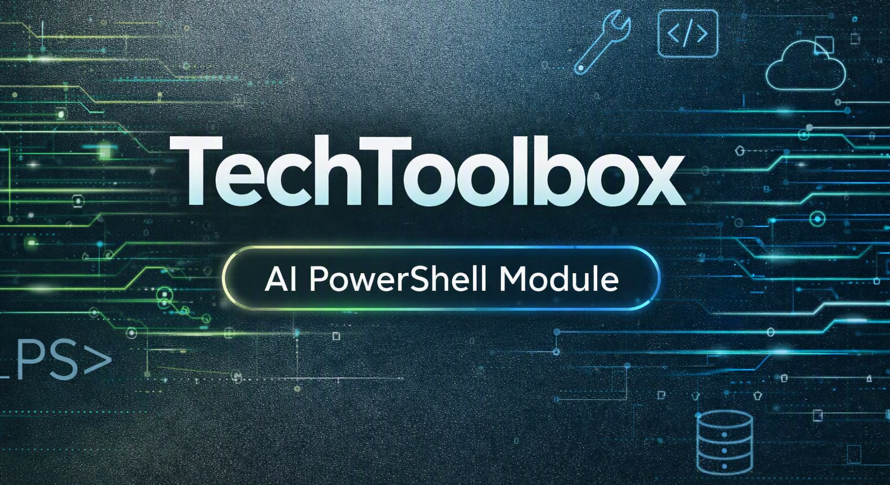

<p align="center">
  
</p>

<p align="center">
  <a href="https://www.powershellgallery.com/packages/TechToolbox"></a>
  <a href="https://www.powershellgallery.com/packages/TechToolbox"></a>
  <a href="https://github.com/dan-damit/TechToolbox/releases"></a>
  <a href="https://learn.microsoft.com/powershell/scripting/install/installing-powershell"></a>
  <a href="https://thedamits.com/"></a>
</p>

## TechToolbox

TechToolbox is a PowerShell 7.4+ module for identity, Microsoft 365, diagnostics,
endpoint maintenance, networking, remoting, and AI-assisted workflows. Its
commands use shared configuration, logging, worker, and path helpers.

TechAgent is a tool-using agent hosted by the module, with .NET source in
`src/TechToolbox.Agent`. It supports Ollama and cloud LLM providers, configured
MCP tool servers, optional memory and retrieval, and runtime safety checks. The
model proposes actions; the runtime and tool policies govern tool execution.
Destructive actions require operator approval when prompted.

## Quick start

```powershell
Install-Module TechToolbox -Scope CurrentUser
Import-Module TechToolbox
Get-Command -Module TechToolbox | Sort-Object Name
Get-ToolboxHelp
Get-ToolboxHelp -List
Get-Help Invoke-TechAgent -Detailed
```

For a repository checkout, import `./TechToolbox.psd1`. Preview changes with
`-WhatIf` wherever supported:

```powershell
Get-SystemSnapshot
Clear-BrowserProfileData -Browser Chrome -Profiles Default -WhatIf
```

## Architecture

`TechToolbox.psd1` declares module metadata and exports; `TechToolbox.psm1`
sets module and local-data paths, loads private helpers and public scripts, and
exports public functions. Runtime services are initialized when needed.

- `Public/`: PowerShell commands; `Private/`: internal helpers.
- `Workers/`: worker scripts; `Config/config.json`: packaged defaults.
- `src/TechToolbox.Agent/`: TechAgent .NET source, a Git submodule.
- `src/TechShell/`: separate Git submodule.
- `AgentRuntime/`: packaged agent runtime assets.

TechAgent composes configuration, tools, and policies before running its
bounded orchestration loop. MCP discovery/execution, retrieval, memory, and
PowerShell tools are distinct parts of the runtime. Retrieval and memory provide
context, not authorization; model output alone does not authorize an action.

## Configuration

Packaged defaults are under `<module root>\\Config\\config.json`. The loader
uses per-user configuration and secrets at:

- `%LOCALAPPDATA%\\TechToolbox\\Config\\config.json`
- `%LOCALAPPDATA%\\TechToolbox\\Config\\config.secrets.json`

User settings override packaged defaults; the secrets file is a separate
sensitive overlay. Logs and exports are under `%LOCALAPPDATA%\\TechToolbox\\Logs`
and `%LOCALAPPDATA%\\TechToolbox\\Exports`. Inspect settings with
`Get-TechToolboxConfig`, taking care not to expose secrets. Edit per-user config,
not packaged defaults. Partial example:

```json
{
  "settings": {
    "tenant": { "organizationName": "yourdomain.onmicrosoft.com", "upnSuffix": "yourdomain.com" },
    "ad": { "domainController": "dc01.yourdomain.local", "searchBase": "DC=yourdomain,DC=local" }
  }
}
```

Do not store plaintext credentials or API keys. `TT_DisableConfigSecretsMerge=1`
temporarily disables secrets merging for troubleshooting. The old
`TT_ConfigSecretsPath` override is not used by current configuration loading.

## TechAgent

If neither `-Prompt` nor `-PromptFile` is supplied, `Invoke-TechAgent` reads its
configured default prompt, packaged as `%TT_LocalDataRoot%\\CurrentTask.txt`
(`%LOCALAPPDATA%\\TechToolbox\\CurrentTask.txt`). Providers are `ollama`
(default), `openai`, `openai-compatible`, and `azure-openai`.

```powershell
Test-TechAgentProvider -NoNetwork
Invoke-TechAgent -Prompt 'Summarize these logs' -Mode analyze
Invoke-TechAgent -Prompt 'Plan migration steps' -Mode plan -OutputContract markdown
```

Cloud API keys come from the configured environment variable (default
`TT_AGENT_LLM_API_KEY`) or a DPAPI-encrypted secrets value. Use
`Set-TechAgentApiKey` to securely store or manage a key, and
`Test-TechAgentProvider` to validate provider setup. `-Endpoint` selects the
reasoning endpoint, not the embedding endpoint. MCP credentials are separate;
`Set-TechAgentMcpApiKey` manages per-server encrypted keys.

Modes: `execute` runs tools, `plan` plans without tool calls, and `analyze`
provides analysis without tool calls. Legacy `chat` maps to `analyze`.
`-OutputContract` accepts `markdown`, `plain-text`, or `json`;
`-QualityProfile` accepts `precise`, `balanced`, or `creative`;
`-ThinkingMode` accepts `auto`, `on`, or `off`. Prompt controls include
`-StrictPromptPreflight`, `-AutoPromptHint`, and `-AutoRerunFromHint`.

TechAgent provides host-side destructive-action approval: the operator may
approve the presented action, approve destructive actions for the run, or deny.
Keep configured MCP `allowedTools` and `settings.agent.allowedPathRoots` narrow.
The checked-in `settings.agent.policyStartupMode` is `Observe`; do not treat it
as a substitute for action approval or infer further behavior from its name.
Pass non-interactive credentials via `-ToolCredential` or
`-ToolCredentialVariableName`, not in prompt text. See
`Get-Help Invoke-TechAgent -Detailed` for all parameters.

### Memory and retrieval

Checked-in retrieval defaults use the `hybrid` context backend, enable knowledge
retrieval, and disable ordinary pre-run ingestion. Other context backends
include local memory, ripgrep, and state-of-world. Retrieval uses configured
sources and authorized paths; the `rg` backend requires ripgrep.

`-SemanticKnowledgeRetrieval` and `-AutoIngestBeforeRun` independently accept
`Inherit`, `Enabled`, or `Disabled`. `Inherit` uses persisted
`settings.agent.retrieval` values; per-run choices do not change config.
Enabling ingestion does not enable retrieval. Dense embedding work requires an
explicit `embeddingModel` and positive `embeddingDimension`; its optional
`embeddingEndpoint` is independent of reasoning provider/model. Configuring
embedding values alone does not request embedding work.

```powershell
Invoke-TechAgent -Prompt 'Summarize logs' -Provider openai -Model gpt-4o-mini `
    -SemanticKnowledgeRetrieval Disabled -AutoIngestBeforeRun Disabled
Get-TechAgentQualitySummary -Window 20
```

### Task templates

`Use-TechAgentTaskTemplate` manages reusable prompts. Its default destination
is `AI\\Tasks\\CurrentTask.txt`, different from the configured default prompt
path above. Set `-Destination` to align them or pass a staged file with
`-PromptFile`.

```powershell
Use-TechAgentTaskTemplate -List -Category PowerShell
Use-TechAgentTaskTemplate -Pick -Destination "$env:LOCALAPPDATA\\TechToolbox\\CurrentTask.txt"
Invoke-TechAgent
```

## PowerShell commands

Discover commands with `Get-Command -Module TechToolbox`; use
`Get-Help <CommandName> -Detailed`. See [COMMANDS.md](COMMANDS.md) for the
operator index. Public command areas include identity, Exchange/Purview,
system diagnostics, endpoint operations, networking, browser cleanup, and
remoting. Current AI commands include `Invoke-TechAgent`,
`Use-TechAgentTaskTemplate`, `Test-TechAgentProvider`,
`Test-TechAgentMcpConnection`, `Install-TechAgentRuntime`,
`Set-TechAgentApiKey`, `Set-TechAgentMcpApiKey`,
`Set-TechAgentSearchWebApiKey`, and `Get-TechAgentQualitySummary`.

### Common workflows

```powershell
Get-RemoteInstalledSoftware -ComputerName srv01,srv02 -Consolidated
Invoke-AADSyncRemote -ComputerName aadconnect01 -PolicyType Delta
Clear-BrowserProfileData -Browser Chrome -Profiles Default -WhatIf
```

Purview requires a UPN and ticket; a content query may be prompted for based on
config. Preview before execution:

```powershell
Invoke-PurviewPurge -UserPrincipalName analyst@company.com `
    -Ticket INC-151695 -WhatIf
```

## Development and security

`src/TechToolbox.Agent` and `src/TechShell` are Git submodules. Use repository
build/test tooling; see [UPDATABLE-HELP.md](UPDATABLE-HELP.md) for help-feed
maintenance. Use `-WhatIf` where supported, review approval prompts, never
commit secrets, and restrict MCP tools and agent filesystem roots. Check paths
with `Test-TTPathRoots`; check command help and `COMMANDS.md` for current
parameters.

## Metadata

- Author: Dan Damit
- License: MIT
- Module version: 3.4.0
- PowerShell requirement: 7.4.0 or later (Core)
- Repository: [GitHub](https://github.com/dan-damit/TechToolbox)
